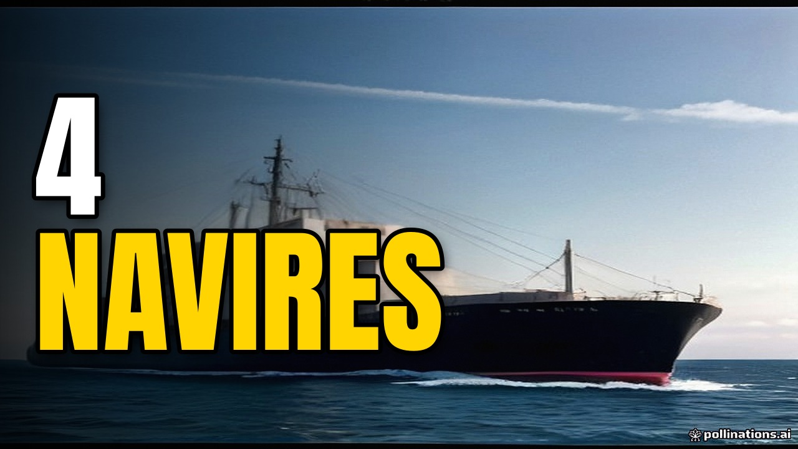

# Miniature — La famine menace l'Europe à cause des guerres en Ukraine et en Iran : blocus du détroit d'Ormuz et engrais bloqués, blé et maïs ukrainiens, flambée du gaz et des prix alimentaires, pénuries qui arrivent, et des dirigeants européens qui n'ont rien anticipé



Image : image générée (pollinations / flux)

**Titre** : Blocage d'Ormuz : famine en Europe
**Variantes A/B** : Comment les guerres bloquent les engrais en Europe · Pénurie alimentaire : la crise du détroit d'Ormuz

**Texte sur l'image** : « 4 navires » — mot en couleur : 4 navires (#FFD400) — à gauche
Police : Anton (latin) / Lalezar (arabe), blanc + contour noir, un seul mot en couleur.

**Image** : Une photo de presse documentaire montrant un porte-conteneurs moderne naviguant dans un plan large de mer calme, avec de grands silos à grains industriels floutés en arrière-plan, symbolisant la chaîne logistique agroalimentaire.

**Prompt** (Midjourney, Ideogram, Flux, Gemini) :
```
Documentary press photo of a large cargo container ship sailing on calm open ocean water, wide shot, industrial grain storage silos visible in the blurred background on the coast, natural daylight, shot on 35mm, slight film grain, realistic colors, clear focus on the maritime trade vessel, empty space on the left side for text.
```
**Prompt négatif** (Midjourney : à mettre après `--no`) :
```
painting, illustration, drawing, cartoon, glowing lights, unreal engine, 8k, hyperrealistic, dramatic fire, explosions, red circles, arrows, dramatic human faces, blurry subject, text, watermark, AI-generated look, CGI, 3D render, plastic skin, oversaturated colors, HDR glow, fantasy lighting, extra fingers, deformed hands, distorted faces, duplicated objects, gibberish text, letters, logo, frame, collage, split screen, emoji
```

**À ne pas faire** : texte généré par l'IA dans l'image · visage réel inventé par l'IA · flèches, cercles rouges, emojis · plus de 3 mots sur l'image · promesse que le live ne tient pas.

**Concurrence (top 3 vues)** :
1. Pétrole  gaz  engrais : le blocage du détroit d'Ormuz pourrait coûter (très) cher — Les Echos — 140 959 vues
2. ALAIN JUILLET balance tout : VOICI la FAMINE qui menace notre avenir ! | GPTV — GÉOPOLITIQUE PROFONDE — 115 663 vues
3. Strait of Hormuz SHUTDOWN: The Iran War Just Triggered a Global Food Crisis (Not Just Oil) — World Affairs In Context — 92 280 vues

Ce qu'on en retient : Les vidéos à succès misent sur un mélange d'imagerie maritime (le détroit) et de symboles alimentaires (silos, blé). On reprend la clarté factuelle du visuel neutre mais orienté sur la logistique plutôt que sur le sensationnalisme.
